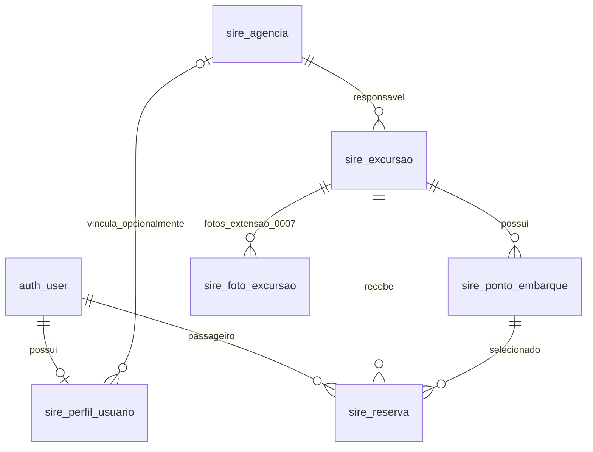

# SIRE — Conferência de casos de uso e modelo relacional (18/11/2026)

**Natureza:** auditoria documental para entrega ao orientador; não substitui o aceite funcional. Conferência do código na branch `etapa/postgresql-windows` (publicação Render 74f50c84), modelo impresso na monografia e documentos-fonte oficiais. Sem edição dos diagramas nativos do Visual Paradigm.

## 1. Fonte de verdade da baseline e caso de uso

- Regras RN-01–RN-41: https://docs.google.com/document/d/1REAmrici0i-JKgP8N78OlN4lVsLUs4blV8A0fE09kQ0/edit
- Especificação formal completa UC01–UC14: https://docs.google.com/document/d/1h5T8l9PPBGralJYaTqjG0K-czRBrGok6tzWRCHenWOY/edit
- Desenvolvimento com Apêndice A (especificações UC01–UC14): https://docs.google.com/document/d/19U5JhTHfk8IbvWfdAAUg8Z81fwQ8wsji6m4vxTN9Ed8/edit
- Monografia: https://docs.google.com/document/d/1SPpcP6bf2Whsq3cCwjYRRDGqV45jsANOofaifG4b6jg/edit
- Código: `sire/models.py` e migrations `0001`–`0007` nesta branch.

### Lista verificada, conforme a especificação original

| ID | Título do caso de uso | Ator predominante |
| --- | --- | --- |
| UC01 | Cadastrar passageiro | Visitante |
| UC02 | Autenticar usuário | Passageiro/Agente |
| UC03 | Consultar catálogo de excursões | Visitante |
| UC04 | Pesquisar excursões | Visitante |
| UC05 | Consultar detalhes da excursão | Visitante |
| UC06 | Cadastrar excursão | Agente |
| UC07 | Editar excursão | Agente |
| UC08 | Cadastrar ponto de embarque | Agente |
| UC09 | Publicar excursão | Agente |
| UC10 | Realizar reserva | Passageiro |
| UC11 | Selecionar ponto de embarque | Passageiro; incluído em UC10 |
| UC12 | Consultar minhas reservas | Passageiro |
| UC13 | Consultar reservas da excursão | Agente |
| UC14 | Consultar passageiros da excursão | Agente |

**Resultado documental:** o diagrama da monografia (Figura 2) apresenta 3 atores e 14 casos de uso; UC10 inclui UC11. O documento de desenvolvimento possui as especificações completas no Apêndice A. O professor precisa receber o link do documento de desenvolvimento, pois o índice da monografia sozinho não apresenta os 14 fluxos completos.

## 2. Modelo relacional: figura histórica e código atual

**Baseline ER-SIRE 2.1 (Figura 4 da monografia): 6 entidades conceituais**: `auth_user` (Django), `sire_agencia`, `sire_perfil_usuario`, `sire_excursao`, `sire_ponto_embarque`, `sire_reserva`.

Relações verificadas com `sire/models.py`:
- `PerfilUsuario.usuario` = `OneToOneField(User, CASCADE)`: 1 conta para 0..1 perfil.
- `PerfilUsuario.agencia` = `ForeignKey(Agencia, null=True, blank=True, PROTECT)`: um perfil tem 0..1 agência; uma agência admite 0..N perfis. O `CheckConstraint perfil_agencia_compativel` obriga AGENTE com agência e PASSAGEIRO sem agência.
- `Excursao.agencia` = FK não nula, `PROTECT`: cada excursão pertence a 1 agência.
- `PontoEmbarque.excursao` = FK `CASCADE`: cada ponto pertence a 1 excursão.
- `Reserva.passageiro` = FK `User` `PROTECT`; `Reserva.excursao` = FK `PROTECT`; `Reserva.ponto_embarque` = FK `PROTECT`: vincula passageiro, excursão e embarque; a regra de pertencimento do embarque é validada no modelo.

**Extensões posteriores, que não se devem retroativamente inserir na Figura 4 histórica:** `0005` inclui `PerfilUsuario.data_nascimento` opcional; `0006` inclui `Excursao.tipo_pacote` opcional; `0007` inclui `Excursao.descricao`, `roteiro`, `inclusos` e cria a **7ª tabela técnica `sire_foto_excursao`**, contendo `excursao_id`, `drive_id` único e `criada_em`. O banco armazena IDs, não bytes de imagem; o armazenamento remoto é Google Drive. O limite de seis fotos pertence à aplicação, não ao esquema da tabela.

### Esquema complementar renderizável (estado atual)

**Atenção de interpretação:** o modelo visual original tem a associação opcional com `Agencia` e descreve a baseline. Não foi confirmado nesta rodada o estado atual do arquivo editável no projeto Visual Paradigm Online; a verificação recai sobre a figura exportada e o Django ORM, não sobre o editor externo. A notação acima é explicativa e não substitui os diagramas UML oficiais.

## 3. Auditoria da monografia realizada nesta rodada

A monografia foi confrontada com a versão pública e revisada em texto para:
1. Identificar PostgreSQL + Render como extensão da implementação inicialmente SQLite;
2. Mencionar filtros e ficha/fotos como incrementos **já desenvolvidos**, deixando claro que o upload no Render ainda carece de comprovação;
3. Distinguir o tutorial EVO-USO-01 de avaliação de usabilidade formal;
4. Declarar que FotoExcursao é extensão `0007`, não a 7ª entidade da baseline;
5. Atualizar a lista de ilustrações e o sumário depois dos acréscimos.

**Bloqueios para declarar aceite integral:** resultados documentados de execução no navegador da demo por dois perfis, TUT-01–06 e prints reais, conferência do vínculo das credenciais OAuth ao Render, revisão final de citações e legendas, confirmação pelo orientador. A auditoria não fabrica esses resultados.

## 4. Entrega ao professor

Recomendado enviar em conjunto: (1) monografia PDF atualizada, (2) documento de desenvolvimento com Apêndice A, (3) este quadro de conferência e o modelo relacional em PDF, (4) link do SIRE publicado, (5) link GitHub e (6) evidências fotográficas de aceitação produzidas em execução separada por Claude. Sem o item 6, o conjunto é um pacote de revisão e **não** um aceite funcional completo.
